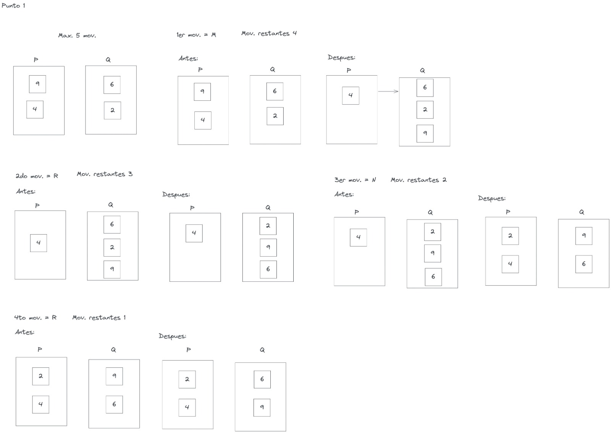
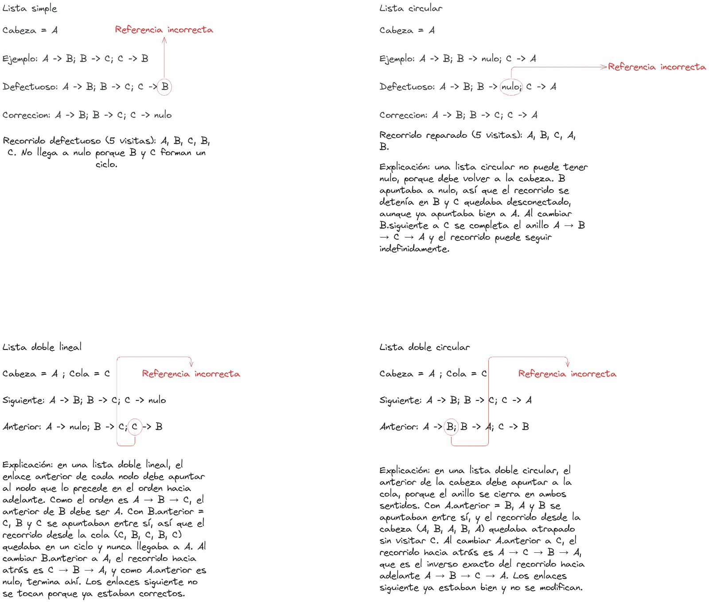
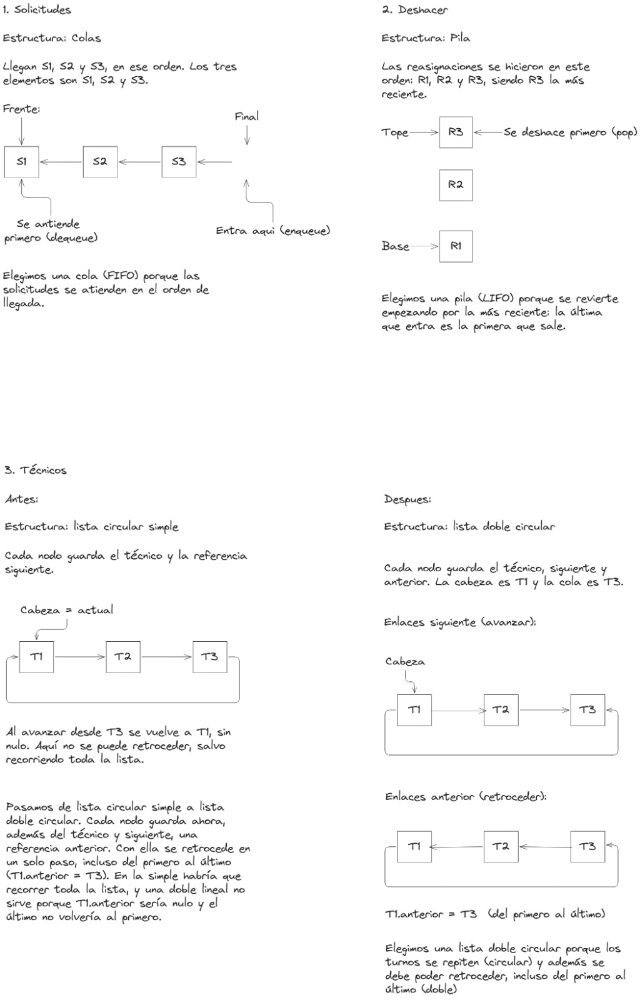
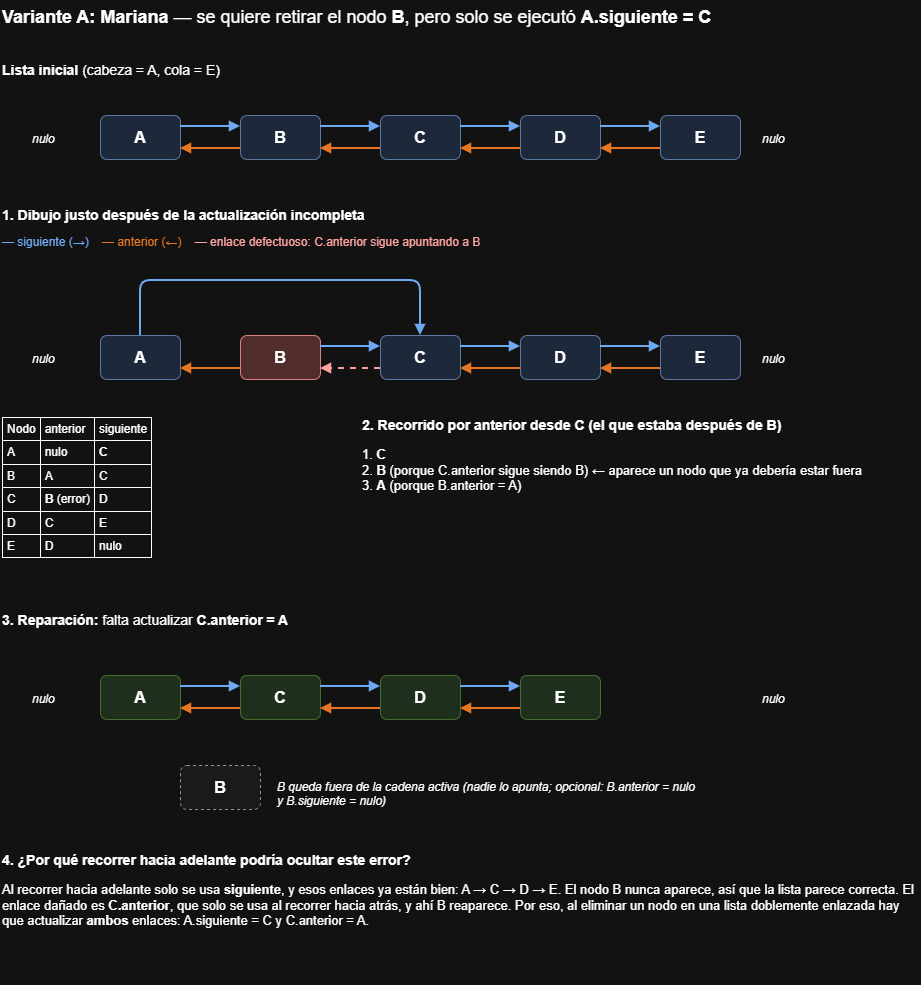
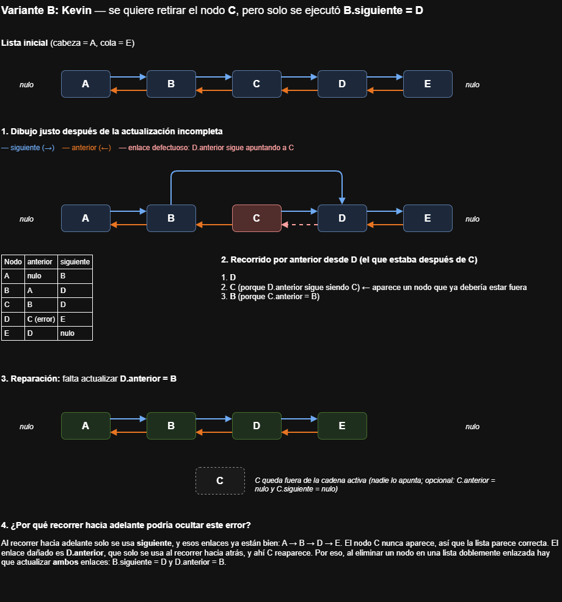
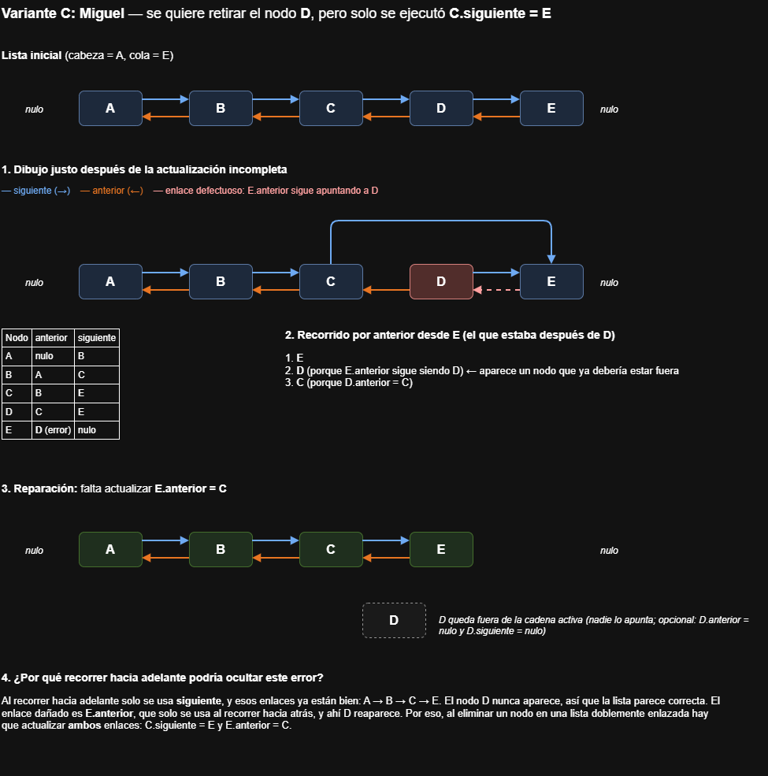

# Examen de pilas, colas y listas

*Equipo N.º:* 550751
*Curso:* Estructura de datos
*Fecha:* 19/10/2026

---

## 1. Integrantes y asignación A/B/C

La asignación se hizo por orden alfabético de apellido, según el registro inicial.

| Rol | Apellidos y nombres | Código estudiantil | Respuesta individual |
|-----|---------------------|--------------------|----------------------|
| A | Berrio Macias, Mariana | 1034920455 | [BerrioMariana-1](./individuales/A.MarianaBerrioMacias.png) |
| B | Correa Torres, Kevin Andres | 1017256307 | [CorreaKevin-2](./individuales/B.KevincorreaTorres.png) |
| C | Montoya Villegas, Miguel Angel | 1193574251 | [MontoyaMiguel-3](./individuales/C.MiguelMontoyaVillegas.png) |

---

## 2. Enlaces a los entregables

### Partes grupales

1. [Parte 1: Movimientos](./01-movimientos.jpeg)
2. [Parte 2: Reparar listas](./02-reparar-listas.jpeg)
3. [Parte 3: Elección de estructuras](./03-eleccion-estructuras.jpeg)

### Respuestas individuales

- [Integrante A: Mariana Berrio Macias](./individuales/A.MarianaBerrioMacias.png)
- [Integrante B: Kevin Andres Correa Torres](./individuales/B.KevincorreaTorres.png)
- [Integrante C: Miguel Angel Montoya Villegas](./individuales/C.MiguelMontoyaVillegas.png)

---

## 3. Quién propuso, dibujó y verificó cada parte

| Parte | Propuso | Dibujó | Verificó |
|-------|---------|--------|----------|
| 01 Movimientos | [A/B/C] | [A/B/C] | [A/B/C] |
| 02 Reparar listas | [A/B/C] | [A/B/C] | [A/B/C] |
| 03 Elección de estructuras | [A/B/C] | [A/B/C] | [A/B/C] |
| Individual A (Mariana) | A | A | A |
| Individual B (Kevin) | B | B | B |
| Individual C (Miguel) | C | C | C |

---

## 4. Vista rápida de las hojas

### Parte 1: Movimientos

### Parte 2: Reparar listas

### Parte 3: Elección de estructuras

### Individual A: Mariana Berrio Macias

### Individual B: Kevin Andres Correa Torres

### Individual C: Miguel Angel Montoya Villegas

